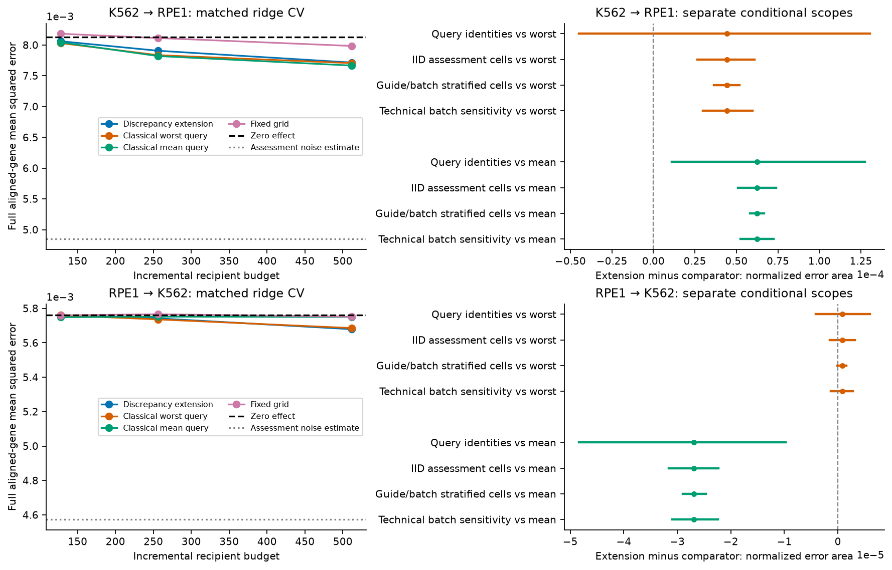

# Frozen external findings

October 22, 2026. All six runs in the [predeclared evaluation](external-evaluation-protocol.md) completed from published source `a04f92ffb9ac867244fc08f4bd82baba89c75138`. The fixed-kernel discrepancy extension **does not improve the primary classical worst-query comparator** in either transfer direction. Its mean error area is slightly higher in both. This is a negative acquisition result for the declared method and information setting, not evidence that budgeted transfer is impossible.

The [full bundle](results/external-evaluation-v1/report-execution.json) contains six reports, compressed per-query metrics, all paid ledgers, allocations, code/configuration/data/split/prediction hashes, source permutations and four paired assessment analyses. The [supplement](results/external-evaluation-v1/supplement/summary.json) covers **848,880 metric rows**, **720 checkpoints**, nine predictors and five acquisition seeds. Both directions use 131 queries and 7,226 aligned genes, with 394 calibration candidates. The same observations and query identities recur across directions; they are not independent biological replications.

## Primary endpoint and uncertainty

The endpoint is full aligned-gene control-relative MSE, averaged over queries and acquisition seeds, then integrated by normalized trapezoidal area over incremental budgets 128/256/512. Negative paired differences favor the extension. Both policies share paid-validation ridge (`ridge_cv`), the same pilot, finite inventory and prices.

| Direction | Extension area | Worst-query area | Paired difference | Relative change | Conditional query 95% band |
| --- | ---: | ---: | ---: | ---: | --- |
| K562 → RPE1 | 0.00786843542 | 0.00782422318 | +4.42122e−5 | +0.5651% | [−4.49572e−5, +1.30315e−4] |
| RPE1 → K562 | 0.00572383458 | 0.00572304598 | +7.88604e−7 | +0.01378% | [−4.15047e−6, +5.94826e−6] |

The query bootstrap first averages seeds within each query. Its bands include zero in both directions. Paired seed-average differences range from −4.34173e−5 to +1.82034e−4 forward and −2.19950e−5 to +3.65418e−5 reverse; seeds describe acquisition variability, not biological replication. All query/seed areas are retained in each run's `areas-by-query-seed.csv`.

The separate fixed-query IID assessment-cell bands are **[+2.65685e−5, +6.10099e−5]** forward and **[−1.55385e−6, +3.17319e−6]** reverse. Technical-batch reweighting gives **[+2.97936e−5, +5.96965e−5]** and **[−1.35585e−6, +2.77025e−6]**, using 56 and 48 observed technical batches. These scopes answer different conditional questions. They neither contradict the wider query band nor form a combined biological interval.

Guide×batch stratification gives narrower bands, but **243/256 forward controls and 247/256 reverse controls are singleton strata**. Treatment singleton cells number **2,558/4,192** and **2,328/4,192**. Resampling within these strata fixes most controls individually and cannot estimate their within-stratum variability. Its narrow bands must not be presented as robust guide/batch uncertainty or independent confirmation. The [four complete analyses](results/external-evaluation-v1/uncertainty) retain these denominators, one shared control resample, and the independent analytic IID variance check.

The prespecified mean-query secondary comparison changes sign: the extension is worse by **6.25666e−5** forward, with query band **[+1.09305e−5, +1.27543e−4]**, but better by **2.69014e−5** reverse, with band **[−4.84089e−5, −9.71939e−6]**. This secondary result does not replace the unfavorable primary comparison or demonstrate consistent improvement.

## Simple predictors and transfer reconstruction

Unlike the Frangieh development setting, zero effect is not the best external point estimate. Under extension acquisition, paid ridge improves on zero by about **3.159%** forward and **0.623%** reverse. Source copy is worse than zero in both directions. The estimated assessment noise floors are **0.00484896740** forward and **0.00457337287** reverse; subtracting them does not remove systematic error or create biological replication.

| Predictor under extension acquisition | K562 → RPE1 area | RPE1 → K562 area |
| --- | ---: | ---: |
| Zero effect; no recipient measurements | 0.0081250839 | 0.0057597313 |
| Shared mean | 0.0141389252 | 0.0113509975 |
| Raw source copy; no recipient measurements | 0.0090291124 | 0.0089424594 |
| Scalar affine | 0.0079964029 | 0.0056852253 |
| Fixed ridge | 0.0175309688 | 0.0169671239 |
| Paid-validation ridge | 0.0078684354 | 0.0057238346 |
| Local residual adaptation | 0.0122195178 | 0.0118158927 |
| Recipient-local low-rank network | 0.0101421273 | 0.0088225634 |
| Single-source PerturbMap reconstruction | 0.0116757930 | 0.0102284258 |

All policy/backbone combinations remain in the supplement. Their descriptive rankings must not become a newly selected primary endpoint. Strong shrinkage matters: the extension selects null at 3/15 checkpoints in each unmodified direction. Its remaining penalties are 1,000/10,000 forward and 10,000/100,000 reverse.

The reconstruction has higher **absolute-effect MSE** than its local network under every one of the 16 acquisition policies in each primary direction. Paid validation nevertheless accepts all 720 routes across the six runs. Under extension acquisition, basis rank is 15–16, training runs 16–32 rounds forward and 16–55 reverse, and 27–32 target descriptors are unavailable per checkpoint. [Authenticated diagnostic records](results/external-evaluation-v1/diagnostics/summary.json) retain training/validation identities and optimizer choices. This is a failure of the declared single-source reconstruction at these budgets, not a reproduction or refutation of the original paper.

Absolute and centered outcomes differ: under extension acquisition, the reconstruction's centered response-specific area is 0.00669731 forward and 0.00507083 reverse, better than its local network's 0.00717124 and 0.00545649 despite worse absolute MSE. Centering removes shared across-query components; it does not validate absolute effects, causal ranking or prospective transport.

## Allocation, ablations and source controls

The extension spends more on opening interventions and less on controls than worst-query design. The [allocation figure](results/external-evaluation-v1/figures/allocation-decisions.png) and per-run `allocations.csv` preserve actual spend, controls, perturbed cells, opened conditions and selected penalties at every seed/budget. Joint allocation is feasible in the retrospective interface; its physical feasibility and abstract prices are not verified laboratory savings.

All six ablations and original weight .25 were executed without external selection. Fixed intervention sets and fixed opening order perform worse in both directions, while the effects of removing depth/control adaptation or changing covariance depend on direction and scope. The [complete ablation plot](results/external-evaluation-v1/figures/all-policies-and-ablations.png) shows every policy against the same classical comparator. The zero-weight extension reproduces worst-query ledgers byte for byte for **all ten direction/seed pairs**.

Source identity derangement moves the extension's ridge areas toward zero-effect performance: **0.00812767** forward and **0.00576257** reverse. Query-source gene-coordinate permutation gives **0.00805871** and **0.00576258**. Most original transfer utility disappears, but residual shrinkage/global behavior can survive a permutation; a control is not a certificate that all remaining performance is response-specific. Fixed ridge becomes particularly unstable under gene permutation (areas about 0.134 and 0.275). All nine predictors and four selected policies are retained in each control.

The [permutation/specificity figure](results/external-evaluation-v1/figures/source-permutation-specificity.png) separates absolute and across-query-centered errors. The completion audit verifies that query-gene permutation leaves fixed-grid purchases and zero/shared-mean/recipient-local predictions exactly unchanged at all **30 matched checkpoints**. Public-source weak/strong strata are retained for all methods; no recipient outcome defined these strata.

## Support, source error and deferral

At budget 512, all 655 query/seed records per primary policy are numerically supported conditional on estimated coordinates. Source-half support disagreements are zero throughout all 720 checkpoints, but this is not population identification. The controlled study already demonstrates false apparent support under source noise.

For the extension, source instability flags affect **113/131 queries** forward and **88/131** reverse. The heuristic combined support/stability filter therefore retains only 13.74% and 32.82% at most. [Actual-retention curves](results/external-evaluation-v1/figures/risk-retention.png) often show higher absolute MSE after that filter: retaining stronger source responses can select harder queries. Deferral is not calibrated to a risk guarantee. At budget 512, mean source-half ridge-CV displacement MSE is 0.000322419 forward and 0.00000467137 reverse, holding purchases fixed. Acquisition policies and neural predictors are not refit in that sensitivity analysis.

Fixed-ridge Gaussian fields at that budget show noisy-contrast compatibility about 93.68%/94.31% and mean widths 0.3517/0.3417 for the extension. These compare intervals against noisy assessment contrasts, not unknown population truth; regularization, adaptation, source error and model bias prevent a population-coverage claim.

## Integrity, resources and limits

The [completion audit](evidence/external-completion-audit-v1.json) authenticates every prediction artifact/index and complete paid-ledger prefix, independently checks inventory membership, non-reuse, scorer exclusion, costs and budgets, and verifies all six scorer openings follow the joint gate at **17:09:33.760669 UTC**. First assessment opened at **18:07:21.051535 UTC**. No acquisition or fitting followed any external score.

The exact suite process used **2,297.234375 CPU seconds** and had peak working set **707,694,592 bytes** and peak commit **581,558,272 bytes**, with process-lifetime scope. Elapsed runtime was **30,223.7883943 seconds**, including observed long event gaps. The manifest's historical `uninterrupted_suite_runtime_seconds` field measures one process invocation's elapsed time, not continuous CPU activity. [Windows CPU counters](evidence/external-process-cpu-v1.json) distinguish these quantities and exclude child-process CPU. Reporting/auditing time is separate. One worker and one BLAS thread were used; no paid compute was used.

Each direction uses 50,912 supplied source cells and 4,448 scorer-only cells. The shared development exposure is 6,428 units; total budget ceilings are 6,556/6,684/6,940. These scopes are separate from each counterfactual policy's paid recipient observations. Zero/source-copy measurement use-cost is zero. Raw/prepared matrices and large predictions remain ignored; [reproduction commands](external-reproduction.md) regenerate them.

The independent [raw/prepared audit](evidence/prepared-row-audit-v1.json) reproduces the complete retained metadata/selection for all **166,118 rows** across Frangieh/K562/RPE1. Twenty sampled rows per input reproduce every full-panel normalized-log expression value exactly: **820,480 float32 entries**, zero discrepancies. Complete files are hash-verified. This is a full metadata and sampled expression check, not an independent recomputation of every matrix entry. The historical Frangieh/K562 preparation module hashes differ from current source; that provenance is preserved rather than rewritten. RPE1's preparation module matches current source, and its historical row-block size 128 differs from reproduction config 969 only in IO batching.

Different released normalization panels, day/effector protocols, guide mixtures, survival/capture selection, missing donors/independent biological replicates, estimated source features, reconstruction choices and inaccessible competitor full methods limit interpretation. No claim of novel priority, biological identification, validated selective coverage, prospective benefit or laboratory cost reduction follows. The supported conclusion is that this specific discrepancy surrogate adds no demonstrated value over the predeclared classical design in the completed external replay.
