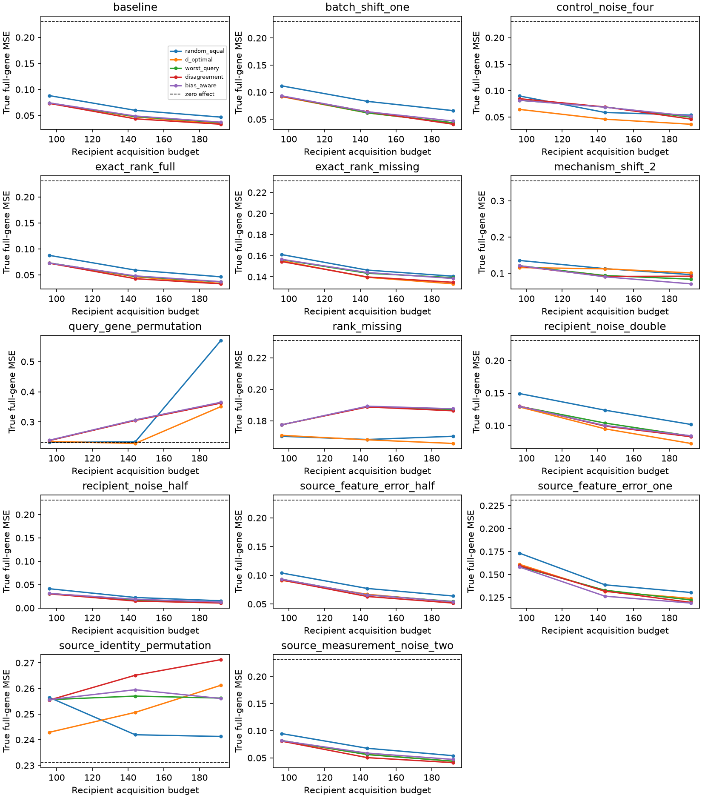

# Controlled study results

All 70 cases completed at acquisition code commit `536e822`. Each of 14 scenarios has five independent generative worlds; each world averages five acquisition seeds and six query identities. Primary backbone: `ridge_cv`. Extension weight: .25, frozen before this study and separate from later development tuning.

The endpoint is normalized true full-gene error area over budgets 96, 144 and 192. Positive differences mean the extension is worse than covariance-correct worst-query design. MCSE is the standard error of the paired world-level difference, using five worlds; it is not a biological interval or a significance claim.

| Scenario | Classical area | Extension area | Paired difference | MCSE of difference | Relative change |
| --- | ---: | ---: | ---: | ---: | ---: |
| baseline | 0.0515476 | 0.0522751 | +0.000727484 | 0.000446457 | +1.41% |
| batch_shift_one | 0.0651054 | 0.0670266 | +0.00192118 | 0.0012782 | +2.95% |
| control_noise_four | 0.0674602 | 0.0677996 | +0.000339367 | 0.000627844 | +0.50% |
| exact_rank_full | 0.051134 | 0.0515652 | +0.000431212 | 0.00060008 | +0.84% |
| exact_rank_missing | 0.145558 | 0.145783 | +0.000224967 | 0.000471103 | +0.15% |
| mechanism_shift_2 | 0.0980498 | 0.0930654 | -0.00498437 | 0.00121124 | -5.08% |
| query_gene_permutation | 0.303867 | 0.304667 | +0.000800146 | 0.000360563 | +0.26% |
| rank_missing | 0.185702 | 0.185946 | +0.000243711 | 0.000243711 | +0.13% |
| recipient_noise_double | 0.105216 | 0.103446 | -0.00177012 | 0.00203019 | -1.68% |
| recipient_noise_half | 0.0191457 | 0.0203034 | +0.00115773 | 0.000297184 | +6.05% |
| source_feature_error_half | 0.0699179 | 0.0698546 | -6.32087e-05 | 0.000799751 | -0.09% |
| source_feature_error_one | 0.136658 | 0.132425 | -0.00423356 | 0.00193174 | -3.10% |
| source_identity_permutation | 0.256483 | 0.257684 | +0.00120113 | 0.00304465 | +0.47% |
| source_measurement_noise_two | 0.0595202 | 0.0615827 | +0.00206251 | 0.000679539 | +3.47% |

The extension has higher mean error in 10 scenarios and lower error in four. Its largest observed gain is 5.08% under nonlinear mechanism shift; it is 1.41% worse in the base linear setting. It is not consistently superior. D-optimal, disagreement, and other baselines remain in the complete tables; the extension is the lowest-error canonical policy in only two scenarios. Fourteen scenario comparisons and five worlds do not support a general superiority claim.

[All policy/backbone paired areas](paired-world-comparisons.csv), [world-level curves](curves-by-world.csv), [support/coverage diagnostics](uncertainty-diagnostics.csv), [allocation summaries](allocation-by-world.csv), [weak/strong source strata and specificity](strata-by-world.csv), [true risk versus retention](true-risk-retention-by-world.csv), and [conditional interval widths](interval-widths-by-world.csv) retain the full analysis.

At budget 192, noiseless missing-direction queries are correctly unsupported (0/150 finite intervals); source measurement noise makes all 150 corresponding query/seed records appear supported although the oracle latent direction remains missing. For `worst_query` with fixed ridge at budget 192, Gaussian true coverage conditional on finite widths is 95.4% in the base setting, 86.4% under nonlinear shift, and 78.1% under persistent source-feature error SD 1. These are descriptive conditional diagnostics. Numerical span in noisy estimated coordinates is not identification in the true latent model, and coverage alone can conceal poor geometry.

Gene-coordinate and identity permutations destroy useful source alignment; extra acquisition can then hurt. The zero-effect reference and every permutation result are retained. Source-stability flags are heuristics and do not detect every form of systematic feature error.

[Case audits](case-audits.zip) retain manifests, prediction indexes, access records, ledgers and allocation events. [Per-query metrics](per-query-metrics.zip) retain both independent assessment and scorer-only truth diagnostics. [The case index](case-index.json) supplies member hashes. Raw cell expression and full prediction arrays remain ignored. All 350 zero-weight-extension ledgers were verified byte-identical to classical acquisition.

Case execution took 2307.2 seconds (38.45 minutes) with one CPU worker. This recorded time and parent resource snapshot precede final plotting/retention; worker lifetime peaks are in the case index. Exact acquisition sources are in code.zip; later diagnostic analysis has a separate script/source ZIP. Synthetic technical batches share offsets across disjoint banks and are not biological replicates.

Reproduce from a checkout of `536e822` using `uv sync --locked --group dev` and `uv run --locked mlresearch study configs/study-controlled-v1.json`. Use a fresh output directory for another run. The retained retention-analysis.py accepts the run and a fresh artifact directory; diagnostic-analysis.py accepts --run and --output. The fixed development resource in this study remains the pre-tuning 4,960-unit record.

This completes the controlled simulation milestone. Real external evaluation, stronger comparator fidelity/integration, source uncertainty, and final common-control analysis remain requirements of the active implementation goal.
