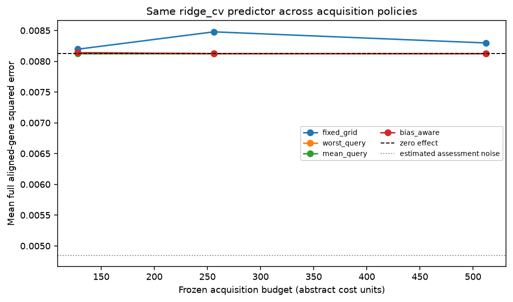
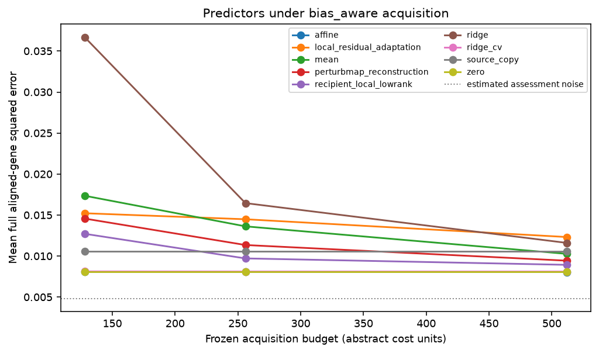

# Replay results

Run label: `Frozen external negative control k562-to-rpe1/identity_permutation; docs/external-evaluation-protocol.md`.

Source-query responses are public; recipient-query responses are scorer-only.

| Policy | Mean error area | Difference vs worst-query | Conditional 95% interval |
| --- | ---: | ---: | ---: |
| fixed_grid | 0.00837271 | 0.00024504 | [0.000129309, 0.000370349] |
| worst_query | 0.00812767 | 0 | [0, 0] |
| mean_query | 0.00812508 | -2.58627e-06 | [-6.1147e-06, 6.5237e-08] |
| bias_aware | 0.00812767 | 0 | [0, 0] |

Descriptive query-intervention bootstrap conditional on source data, fixed split, acquisition seeds, and fixed assessment/control bank. Excludes biological, guide/batch and common scoring-control uncertainty.

Gaussian coverage and risk-retention tables are diagnostic. Adaptive coverage is unvalidated.

These results do not establish prospective benefit, causal transportability, biological replication, or a novel method.
