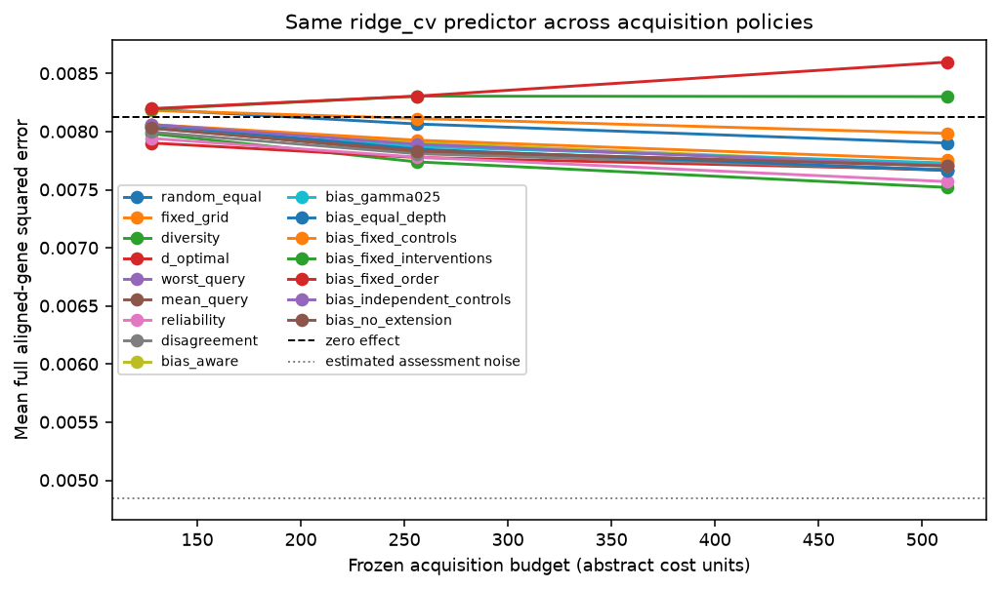
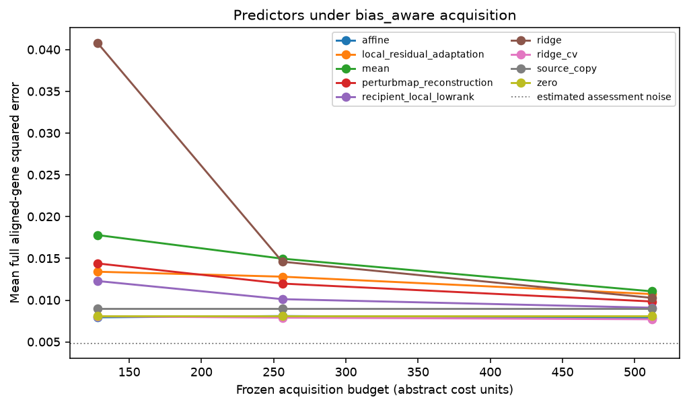

# Replay results

Run label: `Frozen external primary k562-to-rpe1; docs/external-evaluation-protocol.md`.

Source-query responses are public; recipient-query responses are scorer-only.

| Policy | Mean error area | Difference vs worst-query | Conditional 95% interval |
| --- | ---: | ---: | ---: |
| random_equal | 0.00803236 | 0.000208132 | [8.82589e-05, 0.000361611] |
| fixed_grid | 0.00808183 | 0.000257602 | [0.000120192, 0.000424189] |
| diversity | 0.00770698 | -0.000117244 | [-0.000340278, 7.35689e-05] |
| d_optimal | 0.00776331 | -6.09126e-05 | [-0.00030654, 0.000164003] |
| worst_query | 0.00782422 | 0 | [0, 0] |
| mean_query | 0.00780587 | -1.83544e-05 | [-9.53096e-05, 4.42636e-05] |
| reliability | 0.00773737 | -8.68506e-05 | [-0.000228489, 3.61944e-05] |
| disagreement | 0.00779592 | -2.83063e-05 | [-0.000111766, 3.51807e-05] |
| bias_aware | 0.00786844 | 4.42122e-05 | [-4.49572e-05, 0.000130315] |
| bias_gamma025 | 0.00785169 | 2.7468e-05 | [2.04972e-06, 5.57389e-05] |
| bias_equal_depth | 0.0078239 | -3.23597e-07 | [-0.000137861, 0.00012039] |
| bias_fixed_controls | 0.00789336 | 6.91387e-05 | [-2.55683e-05, 0.000161844] |
| bias_fixed_interventions | 0.00828542 | 0.000461195 | [0.000247688, 0.000739537] |
| bias_fixed_order | 0.0083851 | 0.000560881 | [0.000292818, 0.000904431] |
| bias_independent_controls | 0.00785832 | 3.40995e-05 | [-3.97866e-05, 0.000102482] |
| bias_no_extension | 0.00782422 | 0 | [0, 0] |

Descriptive query-intervention bootstrap conditional on source data, fixed split, acquisition seeds, and fixed assessment/control bank. Excludes biological, guide/batch and common scoring-control uncertainty.

Gaussian coverage and risk-retention tables are diagnostic. Adaptive coverage is unvalidated.

These results do not establish prospective benefit, causal transportability, biological replication, or a novel method.
