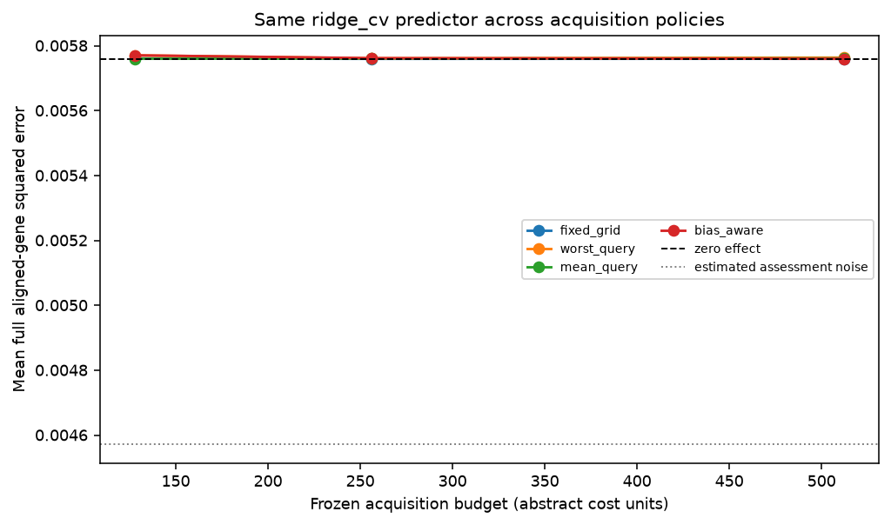
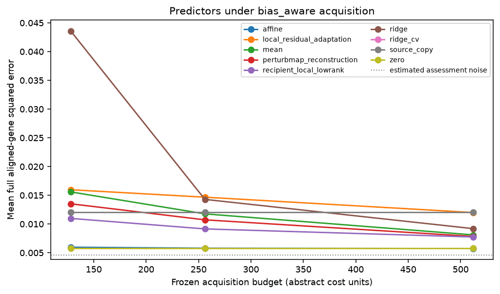

# Replay results

Run label: `Frozen external negative control rpe1-to-k562/identity_permutation; docs/external-evaluation-protocol.md`.

Source-query responses are public; recipient-query responses are scorer-only.

| Policy | Mean error area | Difference vs worst-query | Conditional 95% interval |
| --- | ---: | ---: | ---: |
| fixed_grid | 0.00576001 | -3.55835e-06 | [-5.39569e-06, -1.9755e-06] |
| worst_query | 0.00576357 | 0 | [0, 0] |
| mean_query | 0.00576052 | -3.05182e-06 | [-4.85224e-06, -1.39285e-06] |
| bias_aware | 0.00576257 | -9.96174e-07 | [-1.98139e-06, -1.43627e-07] |

Descriptive query-intervention bootstrap conditional on source data, fixed split, acquisition seeds, and fixed assessment/control bank. Excludes biological, guide/batch and common scoring-control uncertainty.

Gaussian coverage and risk-retention tables are diagnostic. Adaptive coverage is unvalidated.

These results do not establish prospective benefit, causal transportability, biological replication, or a novel method.
