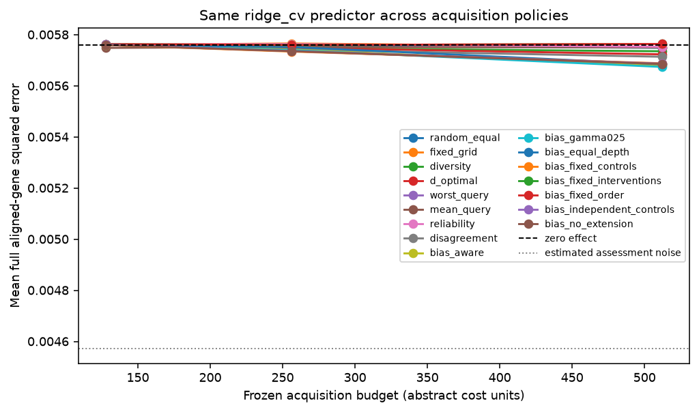
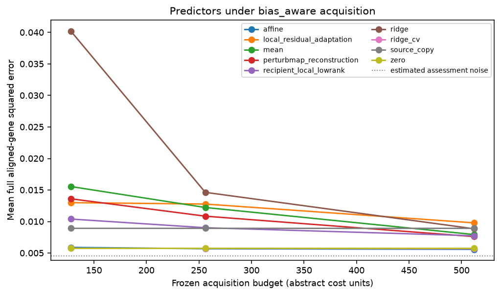

# Replay results

Run label: `Frozen external primary rpe1-to-k562; docs/external-evaluation-protocol.md`.

Source-query responses are public; recipient-query responses are scorer-only.

| Policy | Mean error area | Difference vs worst-query | Conditional 95% interval |
| --- | ---: | ---: | ---: |
| random_equal | 0.00575476 | 3.17142e-05 | [7.48785e-06, 6.32536e-05] |
| fixed_grid | 0.00576008 | 3.7031e-05 | [1.22288e-05, 6.95127e-05] |
| diversity | 0.00574545 | 2.24079e-05 | [2.22432e-06, 4.83072e-05] |
| d_optimal | 0.00574213 | 1.90886e-05 | [3.7544e-07, 4.21389e-05] |
| worst_query | 0.00572305 | 0 | [0, 0] |
| mean_query | 0.00575074 | 2.769e-05 | [1.07656e-05, 4.99657e-05] |
| reliability | 0.0057597 | 3.66554e-05 | [-2.6995e-06, 8.77192e-05] |
| disagreement | 0.00573553 | 1.24869e-05 | [-2.1364e-06, 3.1612e-05] |
| bias_aware | 0.00572383 | 7.88604e-07 | [-4.15047e-06, 5.94826e-06] |
| bias_gamma025 | 0.00572128 | -1.76451e-06 | [-6.79253e-06, 2.31741e-06] |
| bias_equal_depth | 0.005731 | 7.94937e-06 | [-6.36074e-06, 2.22599e-05] |
| bias_fixed_controls | 0.00572308 | 3.56321e-08 | [-7.52474e-06, 6.93604e-06] |
| bias_fixed_interventions | 0.00576163 | 3.8583e-05 | [1.05984e-05, 7.31432e-05] |
| bias_fixed_order | 0.00576167 | 3.86287e-05 | [1.06533e-05, 7.36098e-05] |
| bias_independent_controls | 0.00572394 | 8.9432e-07 | [-1.16399e-05, 1.0994e-05] |
| bias_no_extension | 0.00572305 | 0 | [0, 0] |

Descriptive query-intervention bootstrap conditional on source data, fixed split, acquisition seeds, and fixed assessment/control bank. Excludes biological, guide/batch and common scoring-control uncertainty.

Gaussian coverage and risk-retention tables are diagnostic. Adaptive coverage is unvalidated.

These results do not establish prospective benefit, causal transportability, biological replication, or a novel method.
