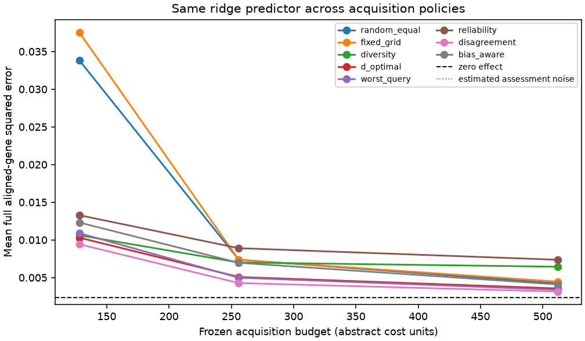
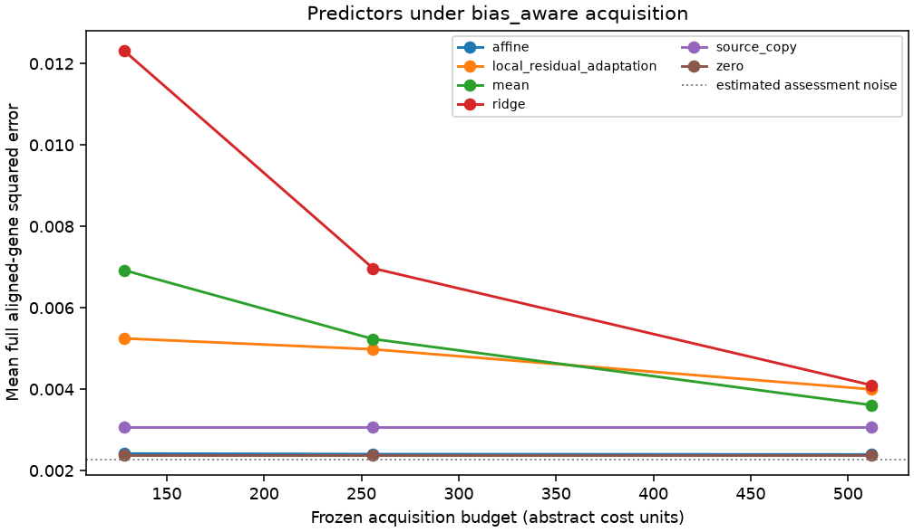

# Replay results

Run label: `exploratory-development; fixed defaults; not final external evaluation`.

Source-query responses are public; recipient-query responses are scorer-only.

| Policy | Mean error area | Difference vs worst-query | Conditional 95% interval |
| --- | ---: | ---: | ---: |
| random_equal | 0.0107503 | 0.00530062 | [0.00390849, 0.00697326] |
| fixed_grid | 0.0114355 | 0.00598583 | [0.00457738, 0.00757644] |
| diversity | 0.00743203 | 0.00198231 | [0.00180822, 0.00214507] |
| d_optimal | 0.0054588 | 9.08166e-06 | [-0.000166796, 0.000172889] |
| worst_query | 0.00544972 | 0 | [0, 0] |
| reliability | 0.00913377 | 0.00368405 | [0.0031584, 0.00423965] |
| disagreement | 0.00477201 | -0.000677703 | [-0.000789815, -0.000578762] |
| bias_aware | 0.0069095 | 0.00145979 | [0.00127469, 0.00166456] |

Descriptive query-intervention bootstrap conditional on source data, fixed split, acquisition seeds, and fixed assessment/control bank. Excludes biological, guide/batch and common scoring-control uncertainty.

Gaussian coverage and risk-retention tables are diagnostic. Adaptive coverage is unvalidated.

These results do not establish prospective benefit, causal transportability, biological replication, or a novel method.
