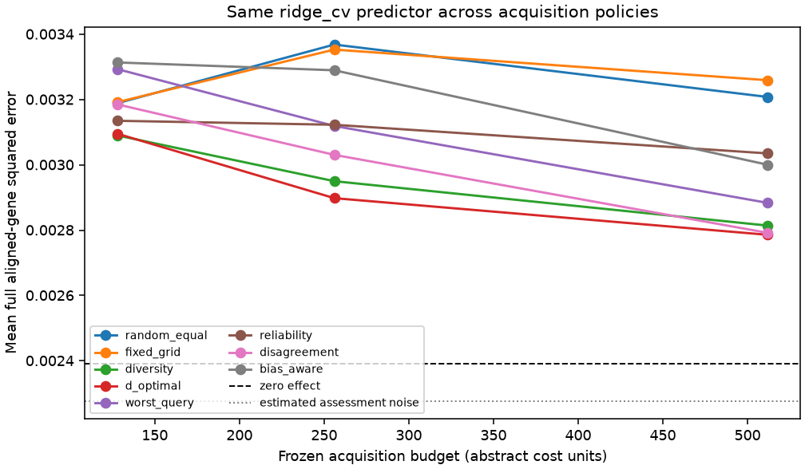
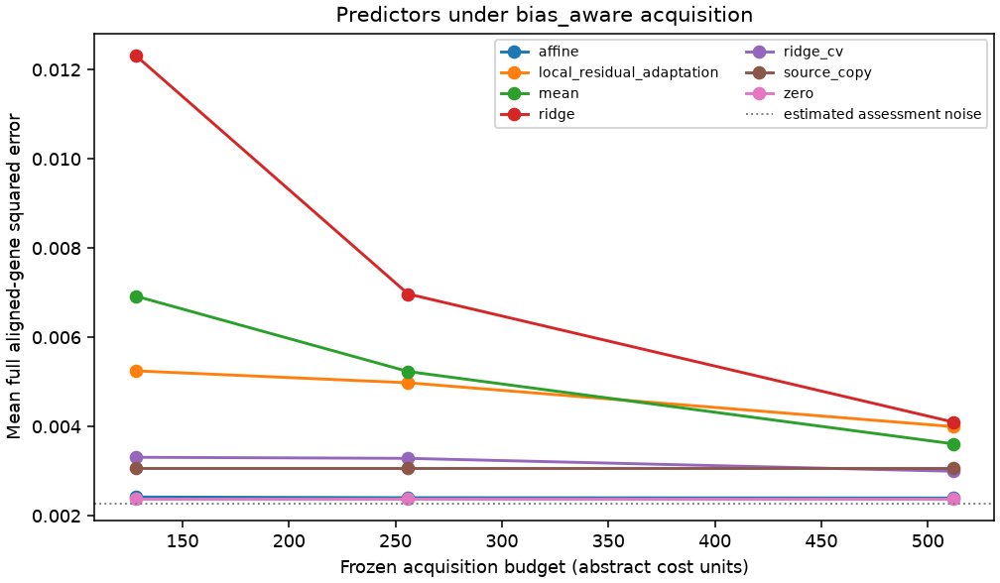

# Replay results

Run label: `development follow-up: paid covariance-correct ridge validation added; original primary fixed-ridge pilot retained`.

Source-query responses are public; recipient-query responses are scorer-only.

| Policy | Mean error area | Difference vs worst-query | Conditional 95% interval |
| --- | ---: | ---: | ---: |
| random_equal | 0.0032849 | 0.000215422 | [0.000152262, 0.000288588] |
| fixed_grid | 0.00329484 | 0.000225364 | [0.00015836, 0.000302883] |
| diversity | 0.00292791 | -0.000141562 | [-0.000167585, -0.000117891] |
| d_optimal | 0.00289337 | -0.000176106 | [-0.00022294, -0.00013449] |
| worst_query | 0.00306947 | 0 | [0, 0] |
| reliability | 0.00309548 | 2.60069e-05 | [-1.31102e-05, 7.53916e-05] |
| disagreement | 0.00297663 | -9.28403e-05 | [-0.000118748, -6.86263e-05] |
| bias_aware | 0.00319709 | 0.000127616 | [8.94631e-05, 0.00017107] |

Descriptive query-intervention bootstrap conditional on source data, fixed split, acquisition seeds, and fixed assessment/control bank. Excludes biological, guide/batch and common scoring-control uncertainty.

Gaussian coverage and risk-retention tables are diagnostic. Adaptive coverage is unvalidated.

These results do not establish prospective benefit, causal transportability, biological replication, or a novel method.
