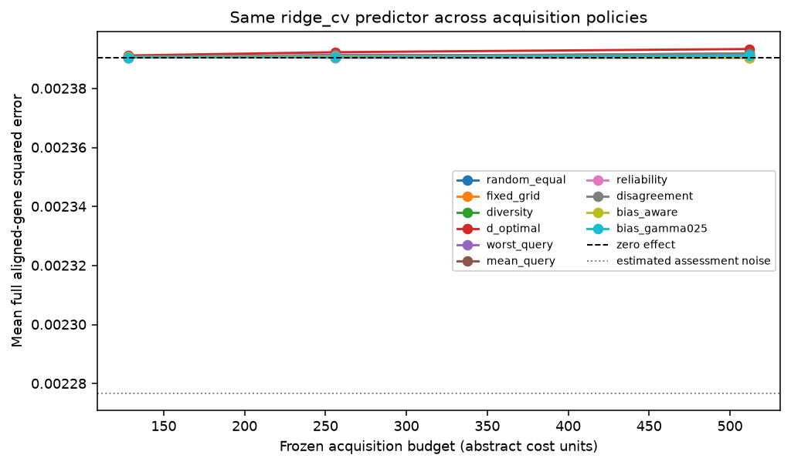
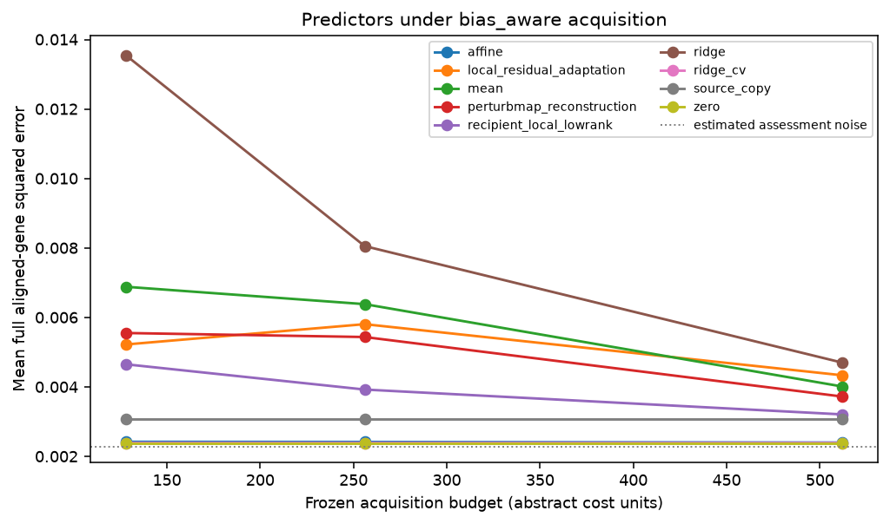

# Replay results

Run label: `Integrated comparator development check under docs/integrated-development-protocol.md; external unopened`.

Source-query responses are public; recipient-query responses are scorer-only.

| Policy | Mean error area | Difference vs worst-query | Conditional 95% interval |
| --- | ---: | ---: | ---: |
| random_equal | 0.00239073 | -4.48213e-07 | [-1.1025e-06, 2.1426e-07] |
| fixed_grid | 0.0023905 | -6.80883e-07 | [-1.43369e-06, 6.89215e-08] |
| diversity | 0.00239054 | -6.34327e-07 | [-1.31656e-06, 5.67105e-08] |
| d_optimal | 0.00239246 | 1.27772e-06 | [-2.94896e-07, 2.9788e-06] |
| worst_query | 0.00239118 | 0 | [0, 0] |
| mean_query | 0.00239111 | -6.95111e-08 | [-5.94822e-07, 4.5423e-07] |
| reliability | 0.00239047 | -7.08458e-07 | [-1.449e-06, 3.33323e-08] |
| disagreement | 0.00239128 | 9.87196e-08 | [-4.48097e-07, 6.68601e-07] |
| bias_aware | 0.00239065 | -5.26962e-07 | [-1.26864e-06, 2.21017e-07] |
| bias_gamma025 | 0.00239071 | -4.63238e-07 | [-1.06536e-06, 1.59338e-07] |

Descriptive query-intervention bootstrap conditional on source data, fixed split, acquisition seeds, and fixed assessment/control bank. Excludes biological, guide/batch and common scoring-control uncertainty.

Gaussian coverage and risk-retention tables are diagnostic. Adaptive coverage is unvalidated.

These results do not establish prospective benefit, causal transportability, biological replication, or a novel method.
