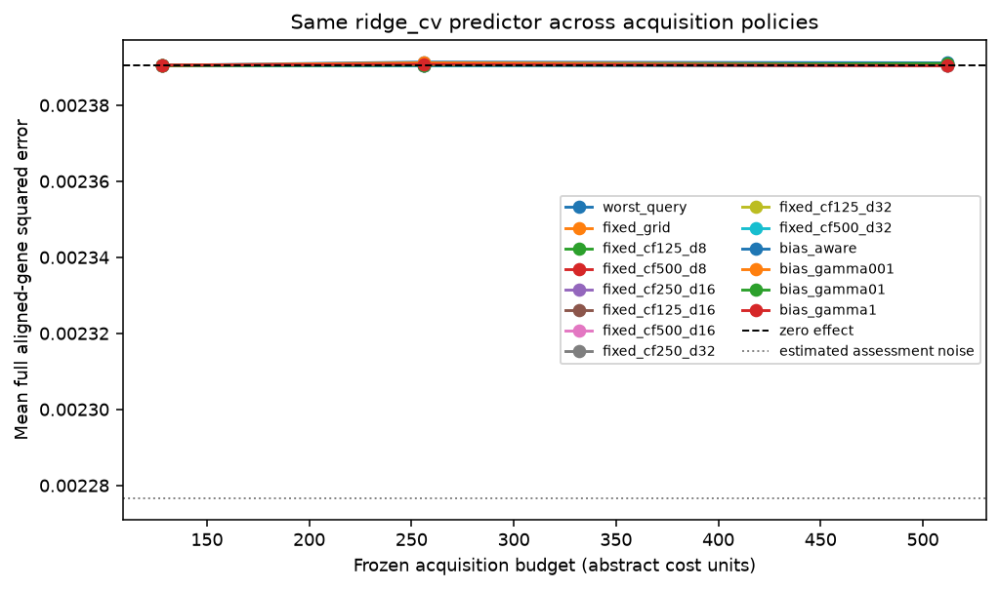
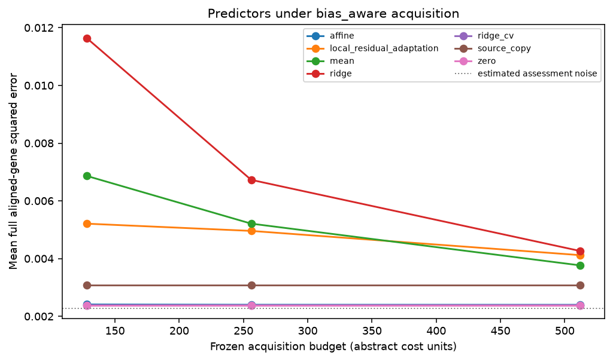

# Replay results

Run label: `Accounted development tuning under docs/development-tuning-protocol.md; external outcomes unopened`.

Source-query responses are public; recipient-query responses are scorer-only.

| Policy | Mean error area | Difference vs worst-query | Conditional 95% interval |
| --- | ---: | ---: | ---: |
| worst_query | 0.00239118 | 0 | [0, 0] |
| fixed_grid | 0.00239061 | -5.65776e-07 | [-1.31455e-06, 1.77734e-07] |
| fixed_cf125_d8 | 0.0023905 | -6.80883e-07 | [-1.43369e-06, 6.89215e-08] |
| fixed_cf500_d8 | 0.00239054 | -6.42629e-07 | [-1.4089e-06, 1.28901e-07] |
| fixed_cf250_d16 | 0.00239067 | -5.09784e-07 | [-1.18417e-06, 1.68651e-07] |
| fixed_cf125_d16 | 0.00239056 | -6.16683e-07 | [-1.28073e-06, 5.64849e-08] |
| fixed_cf500_d16 | 0.00239056 | -6.1721e-07 | [-1.3459e-06, 1.35915e-07] |
| fixed_cf250_d32 | 0.00239053 | -6.45109e-07 | [-1.39056e-06, 9.67386e-08] |
| fixed_cf125_d32 | 0.00239066 | -5.2279e-07 | [-1.26713e-06, 2.29485e-07] |
| fixed_cf500_d32 | 0.00239055 | -6.25203e-07 | [-1.37437e-06, 1.18595e-07] |
| bias_aware | 0.00239071 | -4.63238e-07 | [-1.06536e-06, 1.59338e-07] |
| bias_gamma001 | 0.00239097 | -2.12623e-07 | [-7.72517e-07, 3.64991e-07] |
| bias_gamma01 | 0.00239072 | -4.58003e-07 | [-1.02643e-06, 1.02995e-07] |
| bias_gamma1 | 0.00239065 | -5.26962e-07 | [-1.26864e-06, 2.21017e-07] |

Descriptive query-intervention bootstrap conditional on source data, fixed split, acquisition seeds, and fixed assessment/control bank. Excludes biological, guide/batch and common scoring-control uncertainty.

Gaussian coverage and risk-retention tables are diagnostic. Adaptive coverage is unvalidated.

These results do not establish prospective benefit, causal transportability, biological replication, or a novel method.
