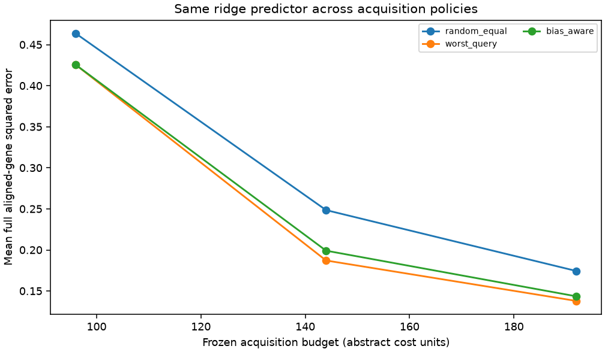
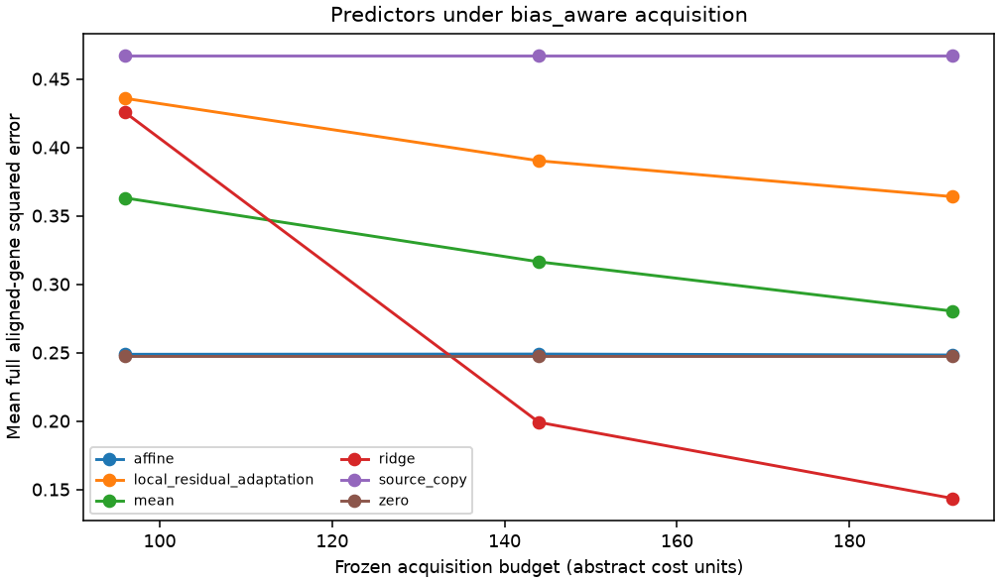

# Replay results

Run label: `offline-synthetic-demo`.

Source-query responses are public; recipient-query responses are scorer-only.

| Policy | Mean error area | Difference vs worst-query | Conditional 95% interval |
| --- | ---: | ---: | ---: |
| random_equal | 0.28384 | 0.0493528 | [0.00941283, 0.0864619] |
| worst_query | 0.234487 | 0 | [0, 0] |
| bias_aware | 0.241864 | 0.00737756 | [0.00345681, 0.0108546] |

Descriptive query-intervention bootstrap conditional on source data, fixed split, acquisition seeds, and fixed assessment/control bank. Excludes biological, guide/batch and common scoring-control uncertainty.

Gaussian coverage and risk-retention tables are diagnostic. Adaptive coverage is unvalidated.

These results do not establish prospective benefit, causal transportability, biological replication, or a novel method.
