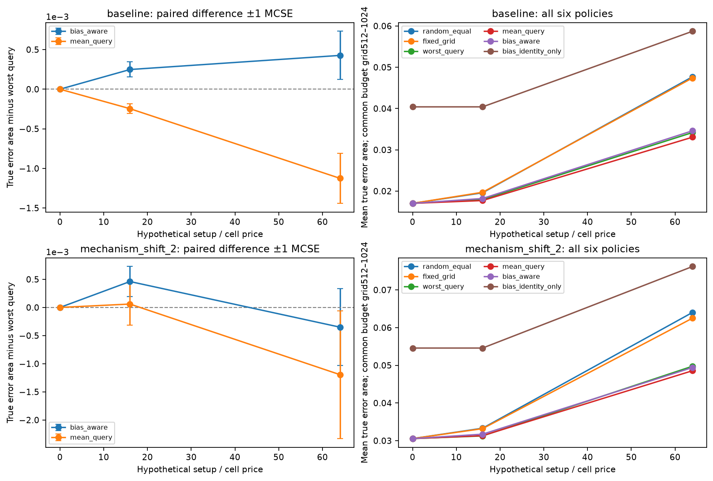
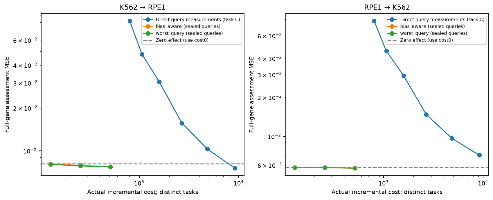
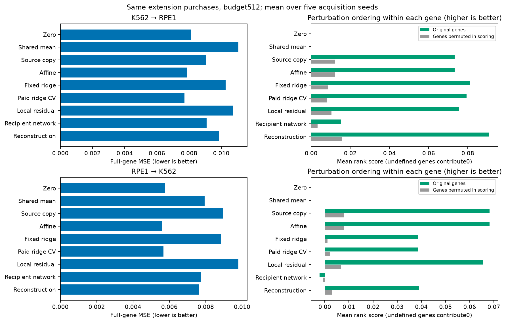
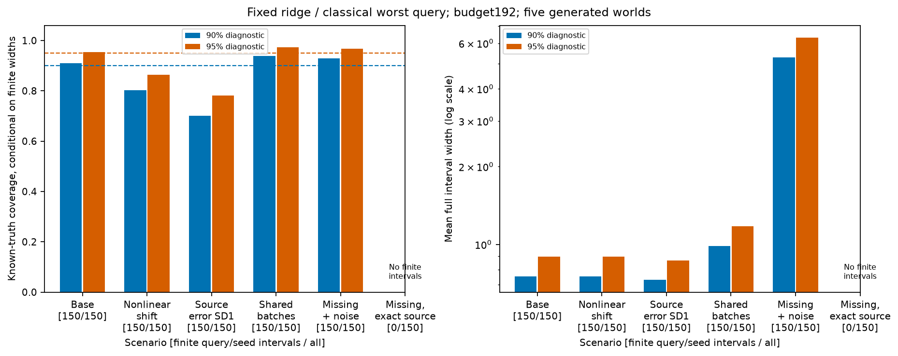

# Secondary completion findings

Completed October 22, 2026, after the primary external evaluation. The [declaration and protocol](secondary-supplement-protocol.md) make the timing explicit. These analyses complete the original plan's secondary checks; they do not change the frozen primary endpoint, comparator, models or negative finding. The retained [bundle](results/secondary-supplement-v1/) includes source, inputs, ledgers, tables and standalone figures.

## Setup cost and joint allocation

Thirty additional controlled cases crossed setup/cell ratios 0, 16 and 64 with baseline/nonlinear-shift scenarios and five independent generated worlds (171–175). Each case used five acquisition seeds, six matched policies, seven shared prediction backbones and budgets 512/768/1,024: 2,700 checkpoints. The same worlds recur across prices/scenarios; this does not create 30 independent replications of one comparison.

| Setup/cell ratio | Extension versus worst-query, baseline | Extension versus worst-query, nonlinear shift |
| --- | ---: | ---: |
| 0 | 0% | 0% |
| 16 | +1.383% | +1.474% |
| 64 | +1.248% | −0.704% |

Positive values mean higher known-truth error area for paid-validation ridge. At price zero all unconstrained policies exhaust the same 496-unit inventory before the first ceiling. At price 16 the unconstrained full pool costs 784; the identity-only ablation can spend only 448. At price 64 the unconstrained methods spend 1,024 at the largest ceiling. The combined identity-only extension fixes depth and controls after the common pilot; its worse error is not a comparison at identical actual expenditure. [Actual spend and paired world summaries](results/secondary-supplement-v1/allocation-analysis/setup-cost-comparisons.csv) retain these distinctions. Figure bars use one Monte Carlo standard error across five worlds, not biological confidence intervals.

## Charged direct-query reference

Task C measures the recipient queries directly and therefore has stronger information than the sealed-query prediction task. Sixty checkpoints crossed two directions, five cell-order seeds and query depths 2/4/8/16/32/64, with independently paid controls and disjoint scorer banks. All 60 prediction arrays and ledgers reproduced exactly in the second execution that added process resource accounting. [Replay verification](evidence/direct-query-resource-replay-v2.json) and [retained ledgers/metrics](results/secondary-supplement-v1/direct-query/) preserve the accounting.

| Charged incremental cost | K562→RPE1 mean MSE | RPE1→K562 mean MSE |
| ---: | ---: | ---: |
| 802 | .081806 | .077914 |
| 1,064 | .047833 | .045673 |
| 1,588 | .030604 | .029491 |
| 2,684 | .015665 | .014744 |
| 4,844 | .010280 | .009680 |
| 9,164 | .007545 | .007157 |

Even the first full-query measurement costs more than the primary 512-unit ceiling. There is no observed equal-cost crossover at primary budgets. These curves compare incremental costs conditional on existing resources. The transfer pipeline's 6,428-unit development exposure and public source atlas remain separate; Task C need not purchase transfer development. This is not a total new laboratory-program cost comparison or evidence of monetary savings.

## Ranking, direction and scoring permutation

Authenticated frozen predictions from all six external runs and 70 original controlled cases yield 109,380 checkpoint/backbone rows. Spearman correlation ranks query perturbations **within each expression gene**, using average ties. Constant predicted/truth genes have undefined correlation, with explicit denominators. A separate fixed-gene aggregate assigns those undefined values a neutral zero; it is not a defined correlation for a constant vector. Genes and seeds are not independent biological replicates.

At budget 512 under extension purchases, paid-validation ridge's fixed-gene rank score is **.07931 forward and .03856 reverse**. All 7,226 genes in all five seeds have defined ranks here (36,130 gene/seed observations per direction). Permuting gene coordinates only in scoring reduces these to .00791/.00207. Zero and shared-mean predictions have no perturbation ordering: their conditional correlations are undefined and their neutral aggregates are zero. Some other checkpoints include null ridge fits; the [full table](results/secondary-supplement-v1/diagnostic-analysis/ranking-by-world.csv) reports the resulting defined fractions rather than dropping them silently.

The reconstruction's forward rank score (.09087) exceeds paid ridge's while its absolute MSE is higher. In reverse, source copy ranks better (.06824 approximately), while its absolute error is much larger. Ranking and absolute-effect estimation therefore answer different questions. A common per-gene control shift cancels in ranks; that invariance does not validate absolute effects or guarantee useful biological ranking.

For the same extension/ridge checkpoints, full-gene sign agreement including zero ties is .51891/.50609, raw direction cosine .08719/.02784, and within-query gene Pearson correlation .08461/.02680. Scoring-coordinate permutation increases MSE from .007715/.005679 to .008587/.005852. These are noisy-assessment diagnostics, not validated signed discoveries. All nine backbones, original/permuted coordinates, centered specificity and defined query/seed denominators remain in the [coordinate table](results/secondary-supplement-v1/diagnostic-analysis/coordinate-metrics-by-world.csv).

## Interval diagnostics and retention

Both nominal levels use the same frozen fixed-ridge variance fields. Independent comparisons reproduce every legacy 95% interval/MSE field at **15,420 checkpoints**. Known-truth controlled results below use worst-query design at budget 192 and five generated worlds, each with five acquisition seeds and six queries.

| Scenario | 90% coverage | 95% coverage | Mean widths, 90% / 95% | Finite query/seed intervals |
| --- | ---: | ---: | ---: | ---: |
| Baseline | 90.91% | 95.40% | .753 / .897 | 150/150 |
| Nonlinear shift | 80.25% | 86.35% | .753 / .897 | 150/150 |
| Source error SD 1 | 70.05% | 78.14% | .728 / .868 | 150/150 |
| Shared batch effects | 93.80% | 97.26% | .988 / 1.177 | 150/150 |
| Missing direction, noisy source | 92.98% | 96.71% | 5.297 / 6.312 | 150/150 |
| Missing direction, exact source | Undefined | Undefined | Undefined | 0/150 |

Coverage entries average gene-coordinate fractions within each finite query/seed interval; 150 is not a biological sample size. The noisy-source missing-direction case produces very wide finite bands despite incorrect apparent support. The exact-source case correctly has no finite intervals. All 14 scenarios and both real directions remain in [world-level tables](results/secondary-supplement-v1/diagnostic-analysis/intervals-by-world.csv). Real values measure compatibility with independent noisy assessment contrasts, not unknown population coverage. Adaptation, transfer misspecification and source estimation prevent a general calibrated-interval claim.

[Distance-only retention](results/secondary-supplement-v1/frozen-diagnostics-complete/distance-and-variance-retention.csv) ranks queries by nearest purchased source-coordinate distance, with stable label-free tie breaking. It is compared with variance, estimated support and source warnings using full query/seed denominators. Thresholds were not chosen from observed errors. None of these diagnostic selectors establishes calibrated selective risk; the primary report retains failures where source-warning filtering selects harder queries.

## Development-selected references and count information

The prospective dossier suggested the strongest development-selected baseline. The actual pre-scoring freeze explicitly used classical worst-query/ridge-CV to isolate the discrepancy term. This is a documented change in primary-comparison choice. Development's strongest overall point estimate was zero; its strongest paid combination was reliability/ridge-CV. Neither was selected from external outcomes.

Post-primary conditional query comparisons find extension/ridge error area 3.159%/.623% lower than zero. Against the strongest paid development combination it is **1.694% higher forward** (paired difference .00013106, conditional 95% query band [.00003691,.00023889]) and **.623% lower reverse** (difference −.00003587, band [−.00008563,.00000231]). [All eight reference comparisons](results/secondary-supplement-v1/diagnostic-analysis/development-reference-comparisons.csv) retain the fixed bank/seed scope and 2,000-draw seed. They do not replace the original primary test or provide a combined biological interval.

The [count-interface audit](evidence/count-interface-sensitivity-v1.json) verifies that capped candidate pools are uniformly 64 cells and source conditions uniformly 96. Adding actual uncapped counts and adversarial annotations to a scratch public inventory leaves every decoded policy field and array unchanged. This establishes a conditional count-blind interface only: the eligible cohort was selected for sufficient observed cells, and survival/capture selection remains.

## Reproduction and failures retained

The [full raw preparation reproduction](evidence/full-preparation-reproduction-v1.json) rebuilds all three inputs with the current checked-in preparation implementation. Every NPY byte and all retained metadata match: **2,405,927,872 float32 entries**, zero differences, including RPE1's changed IO block height. Historical source/manifest hashes remain intact. This is complete numeric reproduction in the pinned Windows environment, not independent biological replication or a second 720-checkpoint experiment.

The first frozen-diagnostic pass completed all 6,480 external rows and then failed because its controlled reader requested `latent_target_effects` instead of the producer's `target_effects`. The [failure and recovery record](evidence/secondary-diagnostics-recovery-v1.json), original source archive and valid external CSV remain retained. The corrected reader passed all 14 scenarios in a bounded smoke; recovery authenticated and reused the external rows, then completed all 76 runs. No primary predictions changed. Sources, resources, input hashes and row counts accompany each final analysis. Use the [reproduction commands](secondary-supplement-reproduction.md) and retained checksums to regenerate the supplement.
